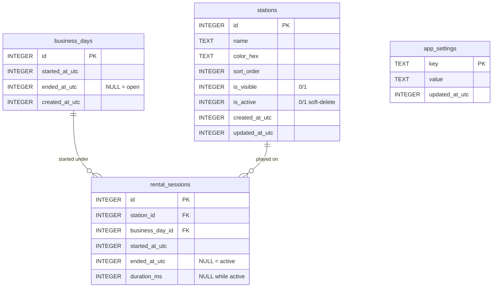

# Data Model — PS Café (SQLite)

## 1. ER diagram


## 2. DDL (canonical, also in `src/db/schema.sql`)
```sql
PRAGMA foreign_keys = ON;
CREATE TABLE business_days(
  id INTEGER PRIMARY KEY AUTOINCREMENT,
  started_at_utc INTEGER NOT NULL,
  ended_at_utc INTEGER NULL CHECK(ended_at_utc IS NULL OR ended_at_utc > started_at_utc),
  created_at_utc INTEGER NOT NULL
);
CREATE UNIQUE INDEX uq_open_day ON business_days(ended_at_utc) WHERE ended_at_utc IS NULL;
-- at most one row with ended_at_utc IS NULL (SQLite treats NULLs distinct, so this
-- partial index is the enforced "one open day" invariant)

CREATE TABLE stations(
  id INTEGER PRIMARY KEY AUTOINCREMENT,
  name TEXT NOT NULL CHECK(length(name) BETWEEN 1 AND 60),
  color_hex TEXT NOT NULL DEFAULT '#2ee6ff',
  sort_order INTEGER NOT NULL DEFAULT 0,
  is_visible INTEGER NOT NULL DEFAULT 1 CHECK(is_visible IN (0,1)),
  is_active INTEGER NOT NULL DEFAULT 1 CHECK(is_active IN (0,1)),
  created_at_utc INTEGER NOT NULL, updated_at_utc INTEGER NOT NULL
);

CREATE TABLE rental_sessions(
  id INTEGER PRIMARY KEY AUTOINCREMENT,
  station_id INTEGER NOT NULL REFERENCES stations(id),
  business_day_id INTEGER NOT NULL REFERENCES business_days(id),
  started_at_utc INTEGER NOT NULL,
  ended_at_utc INTEGER NULL CHECK(ended_at_utc IS NULL OR ended_at_utc >= started_at_utc),
  duration_ms INTEGER NULL CHECK(duration_ms IS NULL OR duration_ms >= 0)
);
CREATE UNIQUE INDEX uq_active_session_per_station
  ON rental_sessions(station_id) WHERE ended_at_utc IS NULL;
CREATE INDEX ix_sessions_day ON rental_sessions(business_day_id);
CREATE INDEX ix_sessions_station ON rental_sessions(station_id);

CREATE TABLE app_settings(key TEXT PRIMARY KEY, value TEXT NOT NULL, updated_at_utc INTEGER NOT NULL);
CREATE TABLE schema_meta(version INTEGER NOT NULL); -- single row, migration ledger
```

## 3. Field lifecycle & rules
- **business_days:** `open` ⇔ `ended_at_utc IS NULL`. Open inside a transaction that first
  checks no open row exists. Close sets `ended_at_utc`; precondition: zero active sessions
  for that day (count `WHERE business_day_id=? AND ended_at_utc IS NULL` must be 0).
- **rental_sessions:** `active` ⇔ `ended_at_utc IS NULL` (+ `duration_ms IS NULL`).
  Start inserts with both NULL; binds current open day id + station id. Stop sets both
  `ended_at_utc` and `duration_ms = ended - started` atomically. History rows immutable after.
- **stations:** never hard-deleted while referenced. Removing = `is_active=0, is_visible=0`;
  history preserved via FK. Deactivating with active session is blocked.
- **app_settings:** reserved for future (e.g. club name). Tab preference is NOT here.

## 4. Timestamp & duration policy
- Store UTC epoch millis (`Date.now()`), `INTEGER`. Display local via `Intl.DateTimeFormat`.
- Live display: `elapsed = Date.now() - started_at_utc`, refreshed 1 s. Persisted duration
  only on stop. Business-day elapsed likewise. Never store calendar date as identity.
- Clock skew: if `now < started_at_utc` (backward adjustment), clamp display to `00:00:00`
  and flag; do not write negative durations (CHECK prevents it; repo surfaces error).

## 5. Statistics definitions (no billing)
- `total_closed_days = COUNT(*) WHERE ended_at IS NOT NULL`
- `total_sessions = COUNT(*) in rental_sessions` (completed; active excluded unless labeled)
- `total_rented_ms = SUM(duration_ms) WHERE ended_at IS NOT NULL`
- `day_open_ms = (ended|now) - started_at` — distinct from `SUM(session duration)` for that day.
- Current-day aggregates filtered by `business_day_id = <open day>`; all-time unfiltered.
- Initial 4 cards (recommended): Closed Days · Total Sessions · Total Rented Hours · Current Day Time.

## 6. Migrations
Ordered integer versions in `db/migrations.ts`, each in a transaction, bumping `schema_meta`.
v1 creates all tables above. Future: additive `ALTER TABLE` only; no destructive rewrites.

## 7. Restart recovery
On launch: `SELECT * WHERE ended_at_utc IS NULL` for days; `SELECT ... WHERE ended_at_utc
IS NULL` for sessions → restore live timers from stored `started_at_utc`. Crash-safe because
every start is already a committed row; nothing lives only in memory.
Rows with invalid start timestamps are excluded from live state (never deleted).
See `docs/POST_RELEASE_HARDENING_REPORT.md` for the verified shutdown/power-loss behavior.

## 8. Integrity risks → mitigations
Double-click start → pre-check + partial unique index returns constraint error, surfaced.
Two open days → partial unique index + transactional open. Orphan session → FK + day id
bound at start. Midnight rollover → no date logic at all. DB replaced on update →
DB lives in Tauri app-data dir, never in `src/` or install dir.
